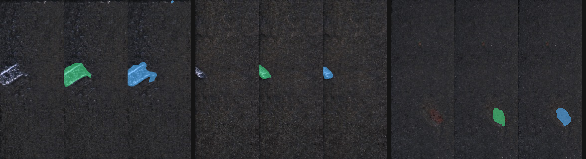

# Python-Defect-Hunter-Game

[English](README.md) | **日本語**

**欠陥ハンター (人間 vs AI)**: KolektorSDD2 (KSDD2) の表面欠陥画像を使った、ブラウザで遊べるゲームです。
欠陥だと思う場所をなぞると、CPU で学習した小さな U-Net が同じ画像を判定し、両方を **IoU** で採点して並べて比較します。



*各例、左から: 入力 · 正解 (緑) · しきい値 0.5 の AI 予測 (青)。test の欠陥画像のうち ID が若い順の 3 枚で、選り好みはしていません。画像は KolektorSDD2 由来です ([ライセンス](#ライセンスと出典) 参照)。*

## このプロジェクトで示していること

| スキル | 場所 |
|---|---|
| 画像の前処理 (リサイズ、3 チャンネル化、マスク処理) | `src/defect_hunter/data.py`, `dataset.py` |
| PyTorch によるセグメンテーション (小型 U-Net、CPU のみ) | `model.py`, `train.py` |
| **指標の自前実装** (IoU / Precision / Recall / F1)。torchmetrics と突き合わせて検証 | `metrics.py`, `tests/` |
| クラス不均衡への対応と、表での比較 | `losses.py`, `configs/exp/`, [結果](#結果) |
| データ品質チェック | `scripts/check_quality.py` → `docs/data_quality.md` |
| 再現性 (乱数シード固定、uv のロックファイル、Docker) | [再現性](#再現性) |
| 配信時にモデルを動かさない Web アプリ | `app.py` (FastAPI) + 素の HTML/Canvas/JS |

## なぜゲームにしたか

セグメンテーションの指標は抽象的です。「F1 = 0.71」と言われても、専門外の人には何も伝わりません。
人に欠陥をなぞってもらい、**自分自身の** Precision / Recall をモデルの値と並べて見せると、数字が実感できます。

- **画像の約 9 割は良品**なので、「毎回『欠陥なし』と答える」戦略は正解率では高く見えますが、役に立ちません。ゲームではこれを直接体験できます。毎回「欠陥なし」と答えると、Recall が崩れます。
- 小さな欠陥の IoU は、人間にも**モデルにも**厳しい指標です。同じ画像で両方が外す様子を見ると、ピクセル単位の指標が低くなる理由が直感的にわかります。
- しきい値スライダーで AI の判定しきい値を動かし、Precision の変化を見られます。

サーバーはモデルを動かしません。予測は PNG の確率マップとして事前に生成し、リクエスト時に行うのはしきい値処理と採点だけです。

## クイックスタート

[uv](https://docs.astral.sh/uv/) が必要です (Python 3.15.1 は `.python-version` で固定)。

```bash
# 1. データを入手し (このリポジトリには含みません。ライセンス参照)、data/raw/KSDD2/{train,test} に置く
# 2. 準備・学習・評価
make prepare          # train/val の層化分割 + 前処理済みキャッシュ (data/processed/)
make check            # データ品質レポート -> docs/data_quality.md
make train            # configs/exp/ の全実験 (CPU で数時間)。結果 -> results/
make eval             # 保存済みチェックポイントを再評価し、results/summary.md を再生成
# 3. 遊ぶ
make assets           # 事前生成の画像・マスク・AI 確率マップ -> outputs/game/
make serve            # http://127.0.0.1:8000
make test             # pytest
```

`make train` は時間がかかります (7 設定 + 上位 3 設定の追加シード)。短いエンドツーエンドの動作確認は `make repro-check` (約 1 分) を使ってください。

## データセット

KolektorSDD2: 約 230×640 px の工業用表面画像と、ピクセル単位の欠陥マスク (公式の train/test 分割をそのまま維持)。

| 分割 | ペア数 | 欠陥あり | 良品 |
|---|---|---|---|
| train | 2331 | 246 (10.6%) | 2085 |
| test | 1004 | 110 (11.0%) | 894 |

- 検証データ: **train の 20%**。欠陥の有無で層化 (シード 42)。→ 学習 1865 / 検証 466。公式の test は、モデルやしきい値の選択には一切使いません。
- 画像サイズはまちまちなので、全て **320×128** にリサイズします (この縮小でも欠陥は全件残ります。`docs/data_quality.md` 参照)。
- 欠陥の面積は小さく、リサイズ前で中央値が約 2,200 px / 画像全体約 145,000 px (約 1.5%) です。
- `train/` に混入していた 2 つの `(copy)` ファイルは、ローダーが無視します。

## 手法

- **モデル**: 深さ 4、基底チャンネル幅 8 の U-Net (約 50 万パラメータ)。ゼロから CPU で 15 エポック、AdamW で学習。
- **指標**は `metrics.py` に外部ライブラリなしで実装し、ランダムなマスクで torchmetrics と突き合わせてテストしています。0 除算になるケース (例: 正解も予測も空) は黙って処理しません。各指標は `empty_value` / `zero_division` 引数を明示的に取り、テストで挙動を固定しています。
  - ピクセル指標は、データセット全体で合算 (micro 平均) します。
  - 画像単位の指標: 予測マスクが 20 ピクセル以上なら、その画像を「欠陥あり」と判定します。
- **不均衡対応** (`configs/exp/*.toml` で切り替え): 素の BCE · `pos_weight` 付き BCE · Dice · BCE+Dice · Focal · Focal+Dice · 欠陥画像を 5 倍多く引く BCE+Dice。
- 判定しきい値は、**検証データだけ**で決めます。

## 結果

test 全体 (1004 枚、欠陥 110 枚)。上位 3 設定は 3 シードの平均±標準偏差、それ以外は単一シード (42)。

| 設定 | シード数 | ピクセル IoU | ピクセル P | ピクセル R | ピクセル F1 | 画像 P | 画像 R | 画像 F1 |
|---|---|---|---|---|---|---|---|---|
| **bce_dice_oversample** | 3 | **0.551±0.013** | 0.762±0.048 | 0.669±0.040 | **0.710±0.011** | 0.731±0.106 | 0.882±0.039 | 0.792±0.052 |
| dice | 3 | 0.421±0.007 | 0.686±0.029 | 0.523±0.024 | 0.592±0.007 | 0.555±0.020 | 0.858±0.034 | 0.673±0.009 |
| focal_dice | 1 | 0.396 | 0.828 | 0.432 | 0.568 | 0.894 | 0.764 | 0.824 |
| bce_dice | 1 | 0.390 | 0.643 | 0.498 | 0.562 | 0.845 | 0.791 | 0.817 |
| bce (基準) | 3 | 0.387±0.023 | 0.642±0.070 | 0.496±0.012 | 0.558±0.025 | 0.751±0.181 | 0.809±0.054 | 0.765±0.087 |
| focal | 1 | 0.359 | 0.566 | 0.496 | 0.529 | 0.762 | 0.873 | 0.814 |
| bce_posw (pos_weight=30) | 1 | 0.293 | 0.352 | 0.639 | 0.454 | 0.915 | 0.782 | 0.843 |

実行ごとの JSON は `results/` にあり、この表は `scripts/summarize.py` で生成しています。

**表の正直な読み方**

- ピクセル単位では、オーバーサンプリング付きの BCE+Dice が明確に最良です (F1 0.710±0.011。2 位は 0.592 で、差はシードの標準偏差の 10 倍以上)。これは検証データでも最良だった設定なので、test を見て選んだわけではありません。
- それ以外の順位は**信頼できません**。結果は 1 または 3 シード、15 エポック、意図的に小さくしたモデルによるもので、検証 F1 もエポックごとに大きく揺れます。中位の設定どうしの差は、シードのばらつきの範囲内です。
- 画像単位のスコアは不安定です (test の欠陥画像は 110 枚だけで、数枚の判定が変わると F1 が数ポイント動きます)。
- `pos_weight=30` は逆効果でした。Recall は上がりましたが、Precision は 0.35 まで落ちました。
- モデルは小さく、CPU で短時間しか学習していません。製品レベルの検査器ではありません。

### しきい値スライダー

ゲームでは、AI のしきい値の初期値は **0.5** で、0.01〜0.99 の範囲で動かせます。test 全体で、画像単位の Precision は 0.78 (しきい値 0.01) から 0.94 (0.99) に上がり、Recall は約 0.85 のままです。つまりスライダーが動かすのは、見逃しではなく誤検出です。予測確率が 0 か 1 に近く、しきい値を動かしても変わるピクセルが少ないためです (理由は検証していません。Dice 項が原因の可能性はありますが、BCE だけのモデルでのしきい値の挙動とは直接比較していません)。

検証データで最適なしきい値は約 0.01 で、シードによってばらつきました。検証 F1 がしきい値に対してほぼ平坦なためで、そのため、単純で説明しやすい 0.5 を初期値に固定しました。

## ゲーム

- 10 問、欠陥あり 6 : 良品 4 (実際の比率は約 1:9 で、そのままだと欠陥が少なすぎて楽しめません)。
- 欠陥をなぞって **提出する**、または **欠陥なし** を押します。何も描かずに提出すると「欠陥なし」と同じ扱いです。
- 採点: 正解マスクとの IoU。良品に「欠陥なし」と答えれば 1.0、良品に何か塗れば 0.0、欠陥ありの画像に「欠陥なし」と答えれば 0.0。
- 5 問・10 問終了時に、あなたと AI の Precision / Recall / F1 (画像単位) が表示されます。**これは 6:4 の出題での値で、実データの分布での値ではありません。** 実データ分布での値は、上の表です。
- 正解はサーバー側だけが持ちます。クライアントが送るのは、なぞったマスクだけです。
- UI には **日本語 / EN の切り替え** があります (右上。選択はブラウザに記憶されます)。文言は `src/defect_hunter/web/static/i18n.json` にあり、両言語が使用中の全キーを定義していることをテストで確認しています。

## 再現性

- 乱数シード固定 (`configs/data.toml`、実験ごとの `seed`)、`uv.lock`、Python は 3.15.1 に固定。
- `make repro-check` は短いモデルを 2 回学習し、結果が**完全に一致する**ことを確認します (`scripts/compare_results.py`、許容誤差 0)。
- Docker (CPU のみ。データセットはライセンスの都合でイメージに**含めません**。実行時にマウントします):

```bash
make docker-build
make docker-repro          # コンテナ内で prepare + repro-check。JSON は outputs/docker/ に保存
# コンテナからゲームを起動 (ホストで `make assets` を実行して outputs/game/ を作っておく)
docker run --rm -p 8000:8000 -v $PWD/outputs/game:/app/outputs/game:ro defect-hunter
```

マシン間の注意: 同じプラットフォームでの繰り返し実行では、結果はビット単位で一致します。macOS と Linux の間では、数値カーネルの違いにより、浮動小数点のごく小さな差が出ます。下の検証表を参照してください。

### 検証 (実際に実行したこと)

| 確認 | 結果 |
|---|---|
| macOS (arm64) で `make repro-check` (2 回) | 一致 (最大差 0) |
| コンテナ (Linux aarch64) 内で `make docker-repro` (2 回) | 一致 (最大差 0) |
| macOS と Linux の結果比較 (同じ短い設定) | **完全一致ではない**: 最大差 1.8e-4 (test のピクセル Recall)、最終エポックの損失は小数第 4 位で異なる |
| コンテナ内の `pytest` | 61 件合格 |
| コンテナからのゲーム起動 | `/`、`/api/config`、`/api/round` が応答 |
| イメージサイズ | 1.95 GB (CPU 専用の torch `2.15.0+cpu`、Python 3.15.1) |

つまり、同じコマンドは**同じプラットフォームでは**同じ結果になります。OS をまたぐと、数値にごく小さな差が出ます。再現性チェックは短い実行 (2 エポック、128 枚) で行いました。15 エポックの本番の実験は macOS でしか実行しておらず、Docker では**再実行していない**ため、そちらでは 1.8e-4 より大きな差が出る可能性があり、測定していません。

## リポジトリの構成

```
configs/        data.toml、exp/*.toml (実験)、quick/ (再現性チェック)、splits.json (ID のみ)
docs/           requirements.md、screen-flow.md (mermaid)、data_quality.md、samples/
results/        実行ごとの JSON + summary.md
scripts/        prepare、check_quality、summarize、reeval、build_game_assets、...
src/defect_hunter/   data、dataset、model、losses、metrics、evaluate、train、app、web/
tests/          pytest (torchmetrics との突き合わせ、データ分割、損失、API、辞書)
```

## ライセンスと出典

- **コード**: [MIT](LICENSE)。対象はコードのみで、データセットと、そこから作った画像 (下記) は**対象外**です。
- **データセット**: [KolektorSDD2](https://www.vicos.si/resources/kolektorsdd2/)。リュブリャナ大学 ViCoS Lab 提供、**CC BY-NC-SA 4.0** (非営利・継承)。`data/` は Git 管理外で、このリポジトリから**再配布してはいけません**。`docs/samples/` に載せた数枚の画像はデータセット由来 (リサイズ、オーバーレイ付き) で、同じライセンスのもと、非営利目的でのみ共有しています。
- 元の研究を引用してください: Božič, Tabernik, Skočaj, *Mixed supervision for surface-defect detection: from weakly to fully supervised learning*, Computers in Industry, 2021.
