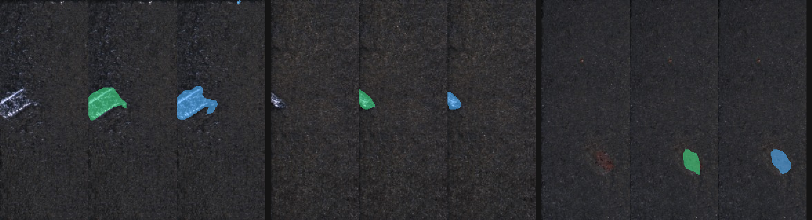

# Python-Defect-Hunter-Game

**English** | [日本語](README.ja.md)

**Defect Hunter: Human vs AI** — a browser game built on the KolektorSDD2 (KSDD2) surface-defect dataset.
You trace the defect you see; a small U-Net I trained on CPU looks at the same image; both are scored by **IoU** and compared side by side.




*Left to right, per example: input · ground truth (green) · AI prediction at threshold 0.5 (blue). The first three defective test images by ID, not hand-picked. Images are from KolektorSDD2 (see [License](#license--attribution)).*

## What this project demonstrates

| Skill | Where |
|---|---|
| Image preprocessing (resize, 3-channel normalisation, mask handling) | `src/defect_hunter/data.py`, `dataset.py` |
| Segmentation in PyTorch (small U-Net, CPU only) | `model.py`, `train.py` |
| **Metrics implemented from scratch** (IoU / Precision / Recall / F1), cross-checked against torchmetrics | `metrics.py`, `tests/` |
| Class-imbalance handling, compared in a table | `losses.py`, `configs/exp/`, [Results](#results) |
| Data quality checks | `scripts/check_quality.py` → `docs/data_quality.md` |
| Reproducibility (fixed seeds, uv lockfile, Docker) | [Reproducibility](#reproducibility) |
| Web app with no model at serve time | `app.py` (FastAPI) + plain HTML/Canvas/JS |

## Why a game?

Segmentation metrics are abstract: "F1 = 0.71" tells a non-specialist nothing.
Letting a person trace defects and then see **their own** Precision / Recall next to the model's makes the numbers tangible:

- **~90% of images are defect-free**, so "just say *no defect*" looks great on accuracy but is useless. The game shows this directly — answer "no defect" every time and your Recall collapses.
- IoU on tiny defects is harsh for humans *and* models; seeing both fail on the same image builds intuition for why pixel metrics are low.
- A threshold slider lets you move the AI's decision threshold and watch Precision change.

The server never runs the model: predictions are precomputed as PNG probability maps, and only thresholding and scoring happen at request time.

## Quick start

Requires [uv](https://docs.astral.sh/uv/) (Python 3.15.1 is pinned in `.python-version`).

```bash
# 1. Get the data (not in this repo — see License) and put it at data/raw/KSDD2/{train,test}
# 2. Prepare, train, evaluate
make prepare          # stratified train/val split + preprocessed cache (data/processed/)
make check            # data quality report -> docs/data_quality.md
make train            # all experiments in configs/exp/ (hours on CPU); results -> results/
make eval             # re-evaluate saved checkpoints, rebuild results/summary.md
# 3. Play
make assets           # precomputed images / masks / AI probability maps -> outputs/game/
make serve            # http://127.0.0.1:8000
make test             # pytest
```

`make train` is slow (7 settings, plus extra seeds for the top 3). For a quick end-to-end check use `make repro-check` (a ~1 minute run).

## Dataset

KolektorSDD2: ~230×640 px industrial surface images with pixel-level defect masks (official train/test split kept as is).

| split | pairs | defective | defect-free |
|---|---|---|---|
| train | 2331 | 246 (10.6%) | 2085 |
| test | 1004 | 110 (11.0%) | 894 |

- Validation set: **20% of train**, stratified by defect/no-defect (seed 42) → 1865 train / 466 val. The official test set is never used for model or threshold selection.
- Images vary in size; all are resized to **320×128** (every defect survives this — see `docs/data_quality.md`).
- Defect area is small: median ≈ 2,200 px out of ~145,000 (≈1.5% of the image) before resizing.
- Two stray `(copy)` files in `train/` are ignored by the loader.

## Method

- **Model**: U-Net, depth 4, base width 8 (~0.5 M parameters), trained from scratch on CPU, 15 epochs, AdamW.
- **Metrics** are implemented without external libraries in `metrics.py` and tested against torchmetrics on random masks. Division-by-zero cases (e.g. empty ground truth *and* empty prediction) are never silent: each metric takes an explicit `empty_value` / `zero_division` argument, pinned by tests.
  - Pixel metrics are micro-averaged over the whole dataset.
  - Image-level metrics: an image counts as "defective" if the predicted mask has ≥ 20 pixels.
- **Imbalance handling** (switchable via `configs/exp/*.toml`): plain BCE · BCE with `pos_weight` · Dice · BCE+Dice · Focal · Focal+Dice · BCE+Dice with 5× oversampling of defective images.
- The decision threshold is chosen **on the validation set only**.

## Results

Test set (1004 images, 110 defective). Mean ± std over 3 seeds for the top three settings; single seed (42) for the rest.

| Setting | Seeds | Pixel IoU | Pixel P | Pixel R | Pixel F1 | Image P | Image R | Image F1 |
|---|---|---|---|---|---|---|---|---|
| **bce_dice_oversample** | 3 | **0.551±0.013** | 0.762±0.048 | 0.669±0.040 | **0.710±0.011** | 0.731±0.106 | 0.882±0.039 | 0.792±0.052 |
| dice | 3 | 0.421±0.007 | 0.686±0.029 | 0.523±0.024 | 0.592±0.007 | 0.555±0.020 | 0.858±0.034 | 0.673±0.009 |
| focal_dice | 1 | 0.396 | 0.828 | 0.432 | 0.568 | 0.894 | 0.764 | 0.824 |
| bce_dice | 1 | 0.390 | 0.643 | 0.498 | 0.562 | 0.845 | 0.791 | 0.817 |
| bce (baseline) | 3 | 0.387±0.023 | 0.642±0.070 | 0.496±0.012 | 0.558±0.025 | 0.751±0.181 | 0.809±0.054 | 0.765±0.087 |
| focal | 1 | 0.359 | 0.566 | 0.496 | 0.529 | 0.762 | 0.873 | 0.814 |
| bce_posw (pos_weight=30) | 1 | 0.293 | 0.352 | 0.639 | 0.454 | 0.915 | 0.782 | 0.843 |

Full per-run JSON files are in `results/`; the table is generated by `scripts/summarize.py`.

**Honest reading of the table**

- BCE+Dice with oversampling is clearly best at the pixel level (F1 0.710±0.011 vs 0.592 for the runner-up; the gap is >10× the seed std). This is also the setting that was best on validation, so it was not picked by looking at test.
- The remaining ranking is **not reliable**: results are from one or three seeds, 15 epochs and a deliberately tiny model, and validation F1 fluctuates a lot between epochs. Differences among the middle settings are within seed noise.
- Image-level scores are noisy (only 110 defective test images; a handful of flips moves F1 by several points).
- `pos_weight=30` hurt: Recall rose but Precision collapsed to 0.35.
- The model is small and trained briefly on a CPU; it is not a production inspector.

### The threshold slider

In the game the AI's threshold defaults to **0.5** and can be moved from 0.01 to 0.99. On the full test set, image-level Precision rises from 0.78 (t=0.01) to 0.94 (t=0.99) while Recall stays near 0.85, i.e. the slider mostly trades false alarms, not misses — the predicted probabilities are close to 0 or 1, so moving the threshold changes few pixels (I did not verify why; the Dice term is a plausible cause, but the BCE-only model's threshold behaviour was not compared directly).

The validation-optimal threshold was ~0.01 and varied between seeds because validation F1 is almost flat in the threshold, which is why 0.5 was fixed as a simple, explainable default.

## The game

- 10 questions, 6 defective : 4 clean (the real ratio is ~1:9, which would make defects too rare to be fun).
- Trace the defect, press **Submit**, or press **No defect**. Submitting an empty canvas counts as "no defect".
- Scoring: IoU against the ground-truth mask. A clean image answered "no defect" scores 1.0; any painting on a clean image scores 0.0; "no defect" on a defective image scores 0.0.
- After 5 and 10 questions you see Precision / Recall / F1 for you and the AI (image level). **These are computed on the 6:4 quiz mix, not on the real data distribution** — the real-distribution numbers are the table above.
- Ground truth stays on the server; the client only sends the traced mask.
- The UI has a **日本語 / EN switch** (top right, remembered in the browser). Strings live in `src/defect_hunter/web/static/i18n.json`; a test checks that both languages define every key used.

## Reproducibility

- Fixed seeds (`configs/data.toml`, per-experiment `seed`), `uv.lock`, Python pinned to 3.15.1.
- `make repro-check` trains a short model twice and checks the results are **identical** (`scripts/compare_results.py`, tolerance 0).
- Docker (CPU only; the dataset is **not** baked into the image because of its licence — mount it at run time):

```bash
make docker-build
make docker-repro          # prepare + repro-check inside the container, JSON saved to outputs/docker/
# run the game from the container (needs outputs/game/ built with `make assets` on the host)
docker run --rm -p 8000:8000 -v $PWD/outputs/game:/app/outputs/game:ro defect-hunter
```

Cross-machine note: results are bit-exact between repeated runs on the same platform. Between macOS and Linux tiny floating-point differences appear (different numerical kernels); see the verification table below.

### Verification (what was actually run)

| Check | Result |
|---|---|
| `make repro-check` on macOS (arm64), 2 runs | identical (max diff 0) |
| `make docker-repro` in the container (Linux aarch64), 2 runs | identical (max diff 0) |
| macOS vs Linux results, same short config | **not** bit-identical: max difference 1.8e-4 (test pixel recall), final-epoch loss differs in the 4th decimal |
| `pytest` inside the container | 61 passed |
| Game served from the container | `/`, `/api/config`, `/api/round` respond |
| Image size | 1.95 GB (CPU-only torch `2.15.0+cpu`, Python 3.15.1) |

So: the same command gives the same result **on the same platform**; across operating systems expect tiny numerical differences. The repro check used a short run (2 epochs, 128 images); the full 15-epoch experiments were run on macOS only and were **not** re-run in Docker, so differences there may be larger than 1.8e-4 and were not measured.

## Repository layout

```
configs/        data.toml, exp/*.toml (experiments), quick/ (repro check), splits.json (IDs only)
docs/           requirements.md, screen-flow.md (mermaid), data_quality.md, samples/
results/        per-run JSON + summary.md
scripts/        prepare, check_quality, summarize, reeval, build_game_assets, ...
src/defect_hunter/   data, dataset, model, losses, metrics, evaluate, train, app, web/
tests/          pytest (metrics vs torchmetrics, data split, losses, API)
```

## License / attribution

- **Code**: [MIT](LICENSE). This covers the code only — **not** the dataset or the images derived from it (below).
- **Dataset**: [KolektorSDD2](https://www.vicos.si/resources/kolektorsdd2/) by the ViCoS Lab, University of Ljubljana, licensed **CC BY-NC-SA 4.0** (non-commercial, share-alike). `data/` is git-ignored and **must not be redistributed** from this repo. The few images shown in `docs/samples/` are derived from the dataset (resized, with overlays) and are shared under the same licence, for non-commercial use.
- Please cite the original work: Božič, Tabernik, Skočaj, *Mixed supervision for surface-defect detection: from weakly to fully supervised learning*, Computers in Industry, 2021.
