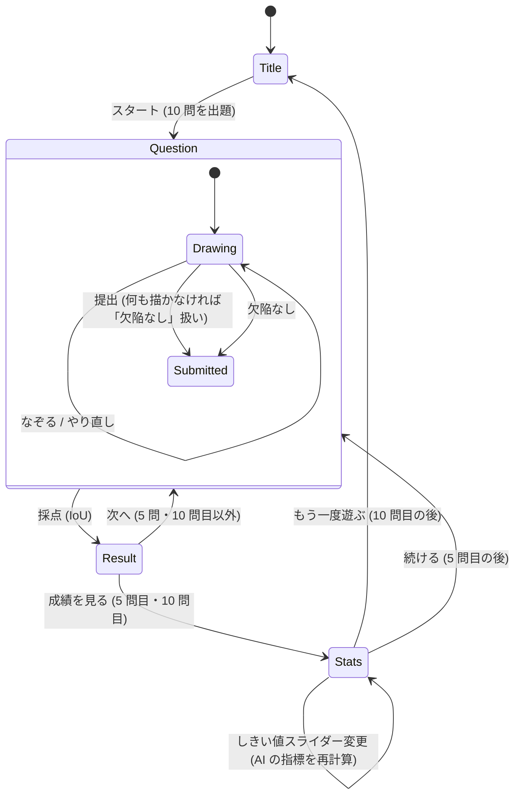
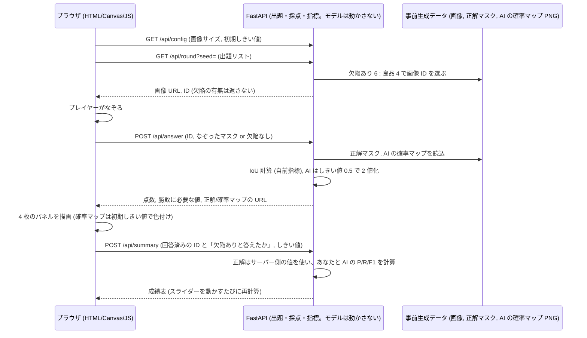

# 画面遷移図: Python-Defect-Hunter-Game

## 画面一覧
| 画面 | 内容 |
|---|---|
| タイトル | ゲーム説明、スタートボタン |
| 出題 | 画像表示、Canvas でなぞる、「欠陥なし」「提出」「やり直し」、ブラシの太さ、進捗バー |
| 結果(1 問) | 元画像・正解・あなた・AI 予測を並べて表示。IoU の点数と勝敗(AI は初期しきい値 0.5 で固定) |
| 成績 | 5 問終了時は「中間成績」、10 問終了時は「最終結果」(同じ画面で見出しだけ変わる)。あなたと AI の Precision / Recall / F1 / 平均 IoU / TP・FP・FN・TN。**AI のしきい値スライダー**はここにある |

全画面共通: 右上に **日本語 / EN スイッチ**(選択はブラウザに保存)。URL に `?seed=整数` を付けると出題が固定される。

## 遷移図

## データフロー

