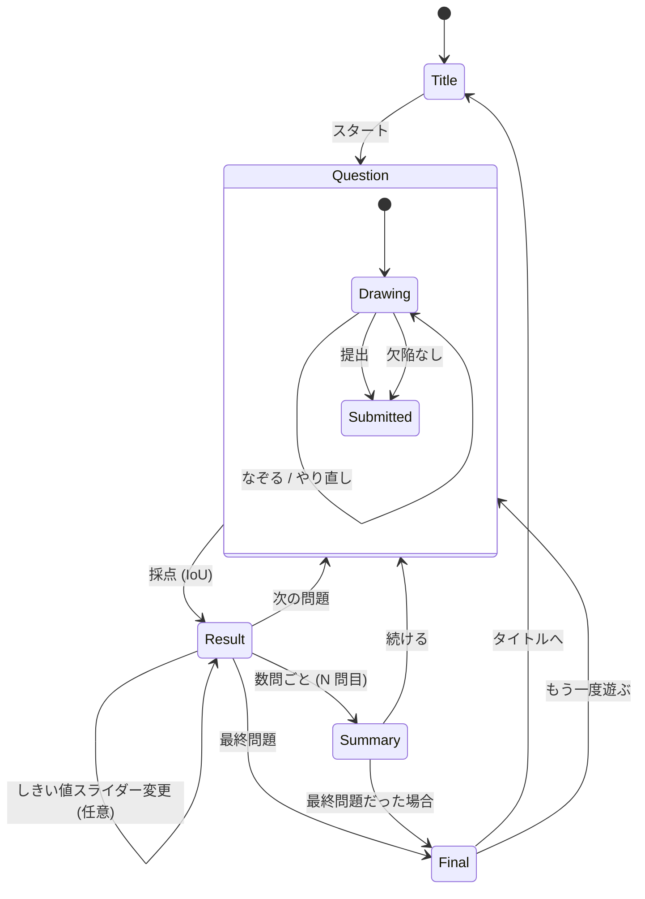
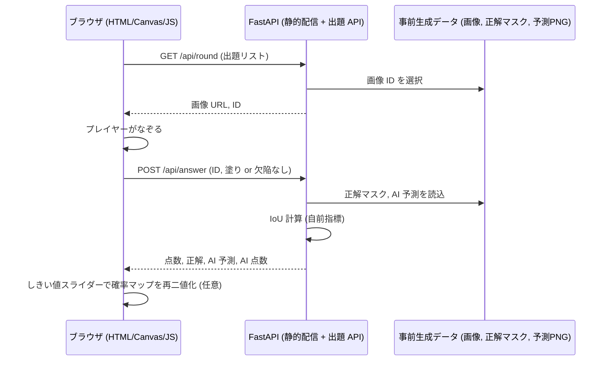

# 画面遷移図: Python-Defect-Hunter-Game

## 画面一覧
| 画面 | 内容 |
|---|---|
| タイトル | ゲーム説明、スタートボタン |
| 出題 | 画像表示、Canvas でなぞる、「欠陥なし」「提出」「やり直し」 |
| 結果(1 問) | 正解マスク、プレイヤー、AI 予測を並べて表示。IoU 点数比較。しきい値スライダー(任意) |
| 中間成績 | 数問ごとにプレイヤーの Precision / Recall / F1(AI と比較) |
| 最終結果 | 総合成績、AI との勝敗、もう一度遊ぶ |

## 遷移図

## データフロー

